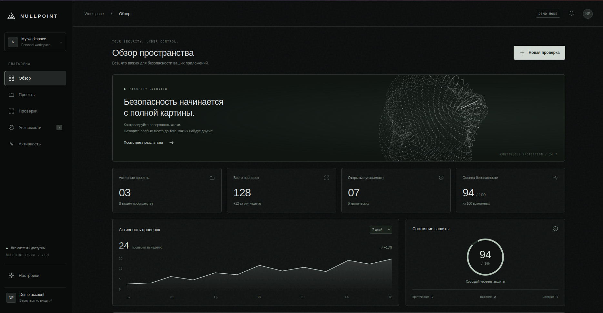

# NULLPOINT

An educational project for exploring HTTP, HTTPS, and web application security. NULLPOINT brings together a C++ networking lab and a React interface prototype.

## Project Goal

Understand how HTTP works, why HTTPS matters, and how data, cookies, and user sessions are protected. Experiments are intended for a local test environment.

Lab topics:

- HTTP vs. HTTPS
- Man-in-the-Middle attacks
- Packet analysis
- Data tampering in transit
- Session hijacking
- Cookies and session management

These are learning topics, not a list of verified, completed modules.

## Application Interface

A dark graphite palette, light typography, and an animated particle sphere rendered with the Canvas API.

### Dashboard

A security overview with sidebar navigation, metrics, an activity chart, projects, and a simulated security check.

*Dashboard design concept. Layout and data may differ from the current React implementation. This is not a screenshot of the running application.*

### Sign In and Registration

- Switch between sign-in and registration forms.
- First name, last name, email, password, and password confirmation during registration.
- Required-field validation and password matching.
- Show or hide passwords with a corresponding eye icon.
- Demo password recovery and SSO dialogs.
- Responsive layout and animated particles.

A sign-in image is not included yet: the original image file is damaged, and capturing the published page requires access to the site.

## Technology Stack

| Component      | Technologies                                   |
| -------------- | ---------------------------------------------- |
| Networking lab | C++20, Boost.Asio, Boost.Beast, OpenSSL, CMake |
| Web interface  | React, CSS, GO, Python                         |
| Frontend build | esbuild, npm                                   |

## Usage

Run experiments only in your own local environment or on systems for which you have explicit permission from the owner.

## License

The original README specifies “GNU” without identifying a particular license or version. Distribution terms should be defined in a `LICENSE` file.
